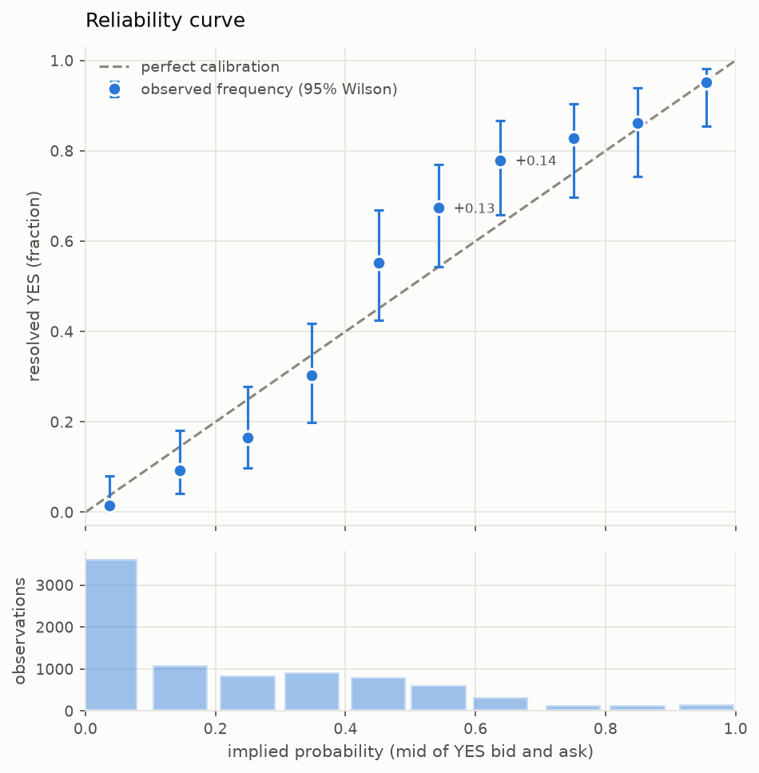
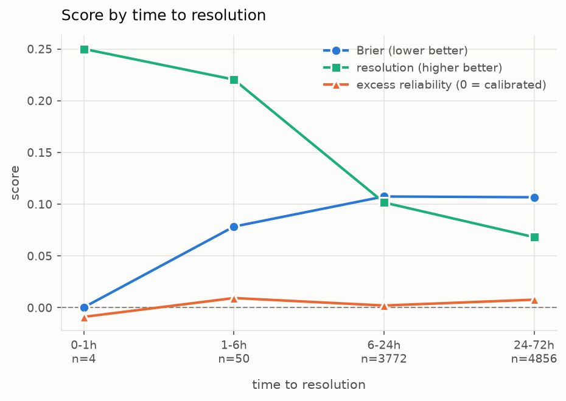

# Kalshi cross-market mispricing: results

Generated 2026-10-29 16:05 UTC by `scripts/build_report.py`.

## What was measured

Two separate questions, deliberately kept apart.

1. **Internal consistency.** Do prices on logically linked contracts contradict each other, and
   if so by how much and for how long? Linked sets are inferred from Kalshi's strike metadata,
   not hand-picked, so the hypothesis is not chosen after seeing the prices.
2. **Correspondence with reality.** Do contracts priced at 70c resolve yes about 70% of the time?
   A market can be perfectly self-consistent and still wrong about the world.

Collection: 1 collector run(s) spanning 0.0 hours, 2 feed gap(s) or disconnect(s) recorded.

### Limitations

These are stated before the findings rather than after, because several of them
bound how much the findings can mean.

**Sample size.** The arbitrage count comes from however long the collector ran on
however many markets. Both are small. A frequency estimate from a handful of
episodes carries an error bar wider than the estimate.

**Survivorship in market selection.** I chose which markets to track. That choice
is upstream of every arbitrage number here. Picking illiquid markets because they
look mispriced would produce violations that are really just stale quotes, and the
selection is not random, so these results do not generalise to the exchange.

**Paper fills are not fills.** Every profit figure is computed from quotes that
were visible, not from trades that happened. It ignores queue position, the
possibility that a quote disappears as you reach for it, and the fact that a
multi-leg package needs every leg to fill or the hedge is broken. A partially
filled arbitrage is an outright position, which is the opposite of what was
intended. Treat the net-edge numbers as an upper bound on what was available, not
an estimate of what was capturable.

**Calibration observations are not independent.** Repeated snapshots of one market
share a single outcome, and markets inside an event resolve together. The row
count overstates the sample by roughly an order of magnitude, which is why
intervals come from a bootstrap over events and the event count is quoted as the
sample size.

**The end bins are the least trustworthy.** Quotes carry observation noise, so a
price near 99c is more often a noisy read on something lower than a true 99%.
Regression to the mean produces apparent miscalibration at the extremes even when
pricing is honest.

**The fee model is from the published schedule, not from fills.** The formula and
the per-series multiplier are read from Kalshi's documentation and API. Nothing
here has been checked against an actual fee charged on an actual trade.


## Findings

### Arbitrage

No scan results are available. Either the collector has not run or the
scanner has not been run against its output with `--write`.


### Calibration

**Headline: no miscalibration is detectable at this sample size.** Measured 12 hours
before resolution on 357 markets, excess reliability is -0.0025 against a
perfectly calibrated null whose 95th percentile is +0.0091 (p = 0.721).

That is not the same as proving the market is well calibrated. It means this much data
cannot tell the difference. On synthetic data this test needed roughly 1600 single-horizon
observations to detect a substantial bias, so a null here is as much a statement about the
sample size as about the market.



| metric | value | reading |
|---|---|---|
| Brier | 0.1068 | lower is better; 0.25 is always saying 50% |
| Brier 95% CI | [0.0932, 0.1213] | bootstrap over events, not rows |
| excess reliability at 12h | -0.0025 | one observation per market |
| null 95th percentile | +0.0091 | what perfect calibration produces here |
| **p-value** | **0.721** | **not distinguishable from calibrated** |
| raw reliability | 0.0065 | calibration error before debiasing |
| noise floor | 0.0019 | what a perfect forecaster scores here |
| **excess reliability** | **+0.0046** | **the real miscalibration** |
| resolution | 0.0826 | discrimination; higher is better |
| uncertainty | 0.1830 | base rate variance; fixed by the questions |
| skill | +0.416 | versus always forecasting the base rate |

Sample: 8682 observations, but only 357 distinct markets and 67 independent events. Quote 67 as the sample size: rows repeat the same outcome, and markets inside an event resolve together.

#### Bins

| bin | n | mean price | resolved yes | 95% CI | gap |
|---|---|---|---|---|---|
| 0.0 to 0.1 | 3622 | 0.037 | 0.015 | [0.003, 0.080] | -0.022 |
| 0.1 to 0.2 | 1091 | 0.146 | 0.093 | [0.042, 0.182] | -0.053 |
| 0.2 to 0.3 | 846 | 0.249 | 0.165 | [0.097, 0.278] | -0.084 |
| 0.3 to 0.4 | 916 | 0.348 | 0.302 | [0.199, 0.418] | -0.046 |
| 0.4 to 0.5 | 810 | 0.451 | 0.553 | [0.425, 0.669] | +0.102 |
| 0.5 to 0.6 | 616 | 0.543 | 0.674 | [0.544, 0.771] | +0.130 \* |
| 0.6 to 0.7 | 326 | 0.638 | 0.779 | [0.659, 0.866] | +0.141 \* |
| 0.7 to 0.8 | 146 | 0.750 | 0.829 | [0.697, 0.904] | +0.078 |
| 0.8 to 0.9 | 144 | 0.849 | 0.861 | [0.743, 0.939] | +0.012 |
| 0.9 to 1.0 | 165 | 0.955 | 0.952 | [0.854, 0.982] | -0.004 |

Brier 0.1068, excess reliability +0.0046, resolution 0.0826, n=8682.

The `*` flags are one test per bin, uncorrected for the ten bins looked at, so a flag or two is what chance alone produces. They are a pointer to where to look, not a finding. The headline test above is the one event-aware test.

#### Does it sharpen as resolution approaches?



Brier falling toward resolution says little on its own, since the outcome becomes obvious.
The informative line is resolution: if it rises early, the market was anticipating rather
than catching up.

| horizon | n | Brier | excess reliability | resolution |
|---|---|---|---|---|
| 0-1h | 4 | 0.0004 | -0.0088 | 0.2500 |
| 1-6h | 50 | 0.0784 | +0.0093 | 0.2204 |
| 6-24h | 3772 | 0.1074 | +0.0021 | 0.1016 |
| 24-72h | 4856 | 0.1067 | +0.0077 | 0.0682 |

## Reproducing this

```bash
.venv/Scripts/python.exe scripts/selftest.py          # offline, no credentials
.venv/Scripts/python.exe scripts/check_auth.py        # verify API credentials
.venv/Scripts/python.exe -m kmm.collect --config config/markets.yaml
.venv/Scripts/python.exe -m kmm.scanner --write
.venv/Scripts/python.exe scripts/fetch_resolved.py --series <TICKER>
.venv/Scripts/python.exe scripts/build_report.py
```

There is no order placement code in this repository. See the scope note in the README.